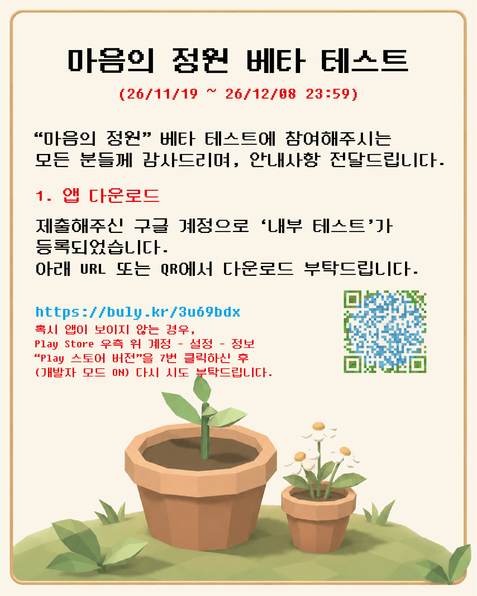

# CapstoneDesign 2026 PBT Guide
안녕하세요, 치킨집 창업을 희망하는 저희 팀이 제작한 **[ 마음의 정원 ]** 베타 테스터로 참여하여 주셔서 대단히 감사하다는 말씀 먼저 올립니다.\
**여러분들의 참여가 헛되지 않도록 꼭 A+ 을 쟁취하도록 하겠습니다.**

## [앱 다운로드 (꼭 먼저!)](https://play.google.com/apps/internaltest/4699994366948661333)
## [사전 설문지 (코드 입력 필요)](https://forms.gle/Ac8PnoAjs31gBdEVA)
##### [사후 설문지 (테스트가 끝나는 시점에 작성해주시면 됩니다)](https://forms.gle/rREPF4L4Bqt6M9Xd9)

## [공지사항 바로가기 >](https://github.com/FriedChickenMakers/CapstoneDesign2026-PBT/blob/main/announcements.md)
공지사항은 rc7 버전 이후 버전의 앱 내 팝업창으로 확인 가능합니다.

> [!NOTE]
> 아래 포스터의 내용에 따라 참여를 진행해주시면 되며, 변경사항이 있는 경우 각 테스터의 초대자 또는 이곳을 통해 공지할 예정입니다.

> [!TIP]
> - 초대가 안 된 경우 : 테스터 등록조차 불가
> - 구글측 처리 지연 : 테스터 등록은 되었으나 앱 다운로드가 안됨 => 최대 1시간 기다려보시고, 동일 초대링크로 들어가서 수락해보시기 바랍니다.

## 안내 포스터

